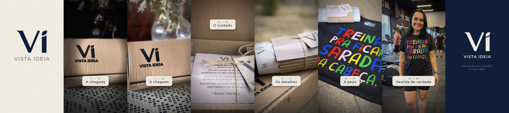

# Vista Ideia — Reels de Unboxing + vitools

Vídeo vertical (1080×1920, 30fps, ~19s) mostrando a evolução do pedido: da caixa fechada à peça vestida,
e o **vitools**, kit em Python que gera esse tipo de vídeo a partir de fotos, logo e um arquivo JSON.



## 🎬 Roteiro
| Tempo | Cena | Legenda |
|---|---|---|
| 0–2s | Intro creme com reveal do símbolo **Vi** | UNBOXING |
| 2–6s | Caixa no escuro → flash → caixa na luz | 01 · A chegada |
| 6–8,5s | Caixa aberta, pan do cartão à tag | 02 · O cuidado |
| 8,5–10,5s | Close no rolinho | 03 · Os detalhes |
| 10,5–13s | Camiseta | 04 · A peça |
| 13–16s | Cliente usando a peça | 05 · Vestida de verdade |
| 16–19s | Outro navy com logo | Obrigado por escolher a Vista Ideia. |

**Identidade:** Navy `#0C1B36` · Creme `#F4EFE4` · Montserrat

---

## 🧰 vitools

### Instalação
Requer Python 3.10+ e **ffmpeg**.
```bash
pip install -r requirements.txt
./scripts/setup_fonts.sh
```

### Renderizar
```bash
python3 render.py projects/unboxing.json            # gera o MP4 + capa
python3 render.py projects/unboxing.json --preview  # + folha de contato com quadros-chave
```

### Ferramentas
| Comando | O que faz |
|---|---|
| `render.py <projeto.json>` | Renderiza o vídeo a partir do JSON |
| `tools/extract_logo.py <arte> --box x0 y0 x1 y1` | Recorta a logo de uma arte e gera as máscaras `mark.png` (símbolo) e `word.png` (assinatura), recoloríveis |
| `tools/contact_sheet.py <video.mp4> -n 8` | Gera uma folha de contato para revisar qualquer vídeo |

### Recursos do motor
- **Ken Burns** com zoom e pan em subpixel, sem nunca mostrar borda vazia
- **Crossfade** entre fotos e **flash** quente em pontos escolhidos
- **Intro e outro** com reveal do símbolo (wipe de baixo pra cima) e assinatura com tracking animado, entrando em cortina
- **Legendas em chip** com contador `01 / 05`, posição configurável por legenda
- **Acabamento:** grão de filme, vinheta e gradiente inferior
- **Capa** exportada automaticamente no instante configurado

### Criar um vídeo novo
1. Coloque as fotos em `assets/fotos/`
2. Duplique `projects/unboxing.json` e edite:

| Campo | Para que serve |
|---|---|
| `brand.primary` / `secondary` | Cores da marca (RGB) |
| `intro.label` / `outro.lines` | Textos das cartelas |
| `shots[]` | `image`, `start`/`end` (s), `zoom` [início, fim], `center` [[x,y] início, [x,y] fim] em pixels da foto original |
| `captions[]` | `num`, `text`, `start`/`end` e `y` opcional (padrão 1290; use ~330 para o topo) |
| `flashes[]` | `at` (s), `width`, `strength` |
| `fx` | Intensidade de `grain`, `vignette` e `bottom_gradient` |

> 💡 Shots consecutivos se sobrepõem ~0,3s; é nessa sobreposição que o crossfade acontece.

Para outra marca, rode `tools/extract_logo.py` na arte dela e aponte `brand.mark`/`brand.word` para os PNGs gerados.

---

## 🎞️ Kits externos

### Guney Motion Kit (`kits/guney-motion-kit`)
Incluído como **submódulo** do repositório original [GTAI-1/guney-motion-kit](https://github.com/GTAI-1/guney-motion-kit), sob licença **GPL-3.0** (os créditos e a licença ficam no próprio kit).

Kit de motion graphics em HTML → vídeo via **HyperFrames** (HeyGen): fundo animado, textos grandes animados, cards 3D, janelas no estilo Claude com zoom, efeitos sonoros (`sfx/`), verificação de quadros e overlay para DaVinci Resolve.

**Complementa o vitools:** o vitools faz vídeos a partir de **fotos** com a identidade da marca; o Guney Motion Kit faz **animações gráficas** (vinhetas, textos cinéticos, explicativos) e traz efeitos sonoros.

```bash
# clonar este repo já trazendo o kit
git clone --recurse-submodules https://github.com/Abel-Odorico/vista-ideia.git

# se já clonou sem ele
git submodule update --init

# usar o kit (requer Node 22+ e FFmpeg)
cd kits/guney-motion-kit
npm run setup
npm run new-video -- vista-ideia-intro
```

Para atualizar o kit para a versão mais recente: `git submodule update --remote kits/guney-motion-kit`.

### YouTube AI Motion Graphics (`kits/youtube-ai-motion-graphics`)
Incluído como **submódulo** do repositório original [sirioberati/YouTube-AI-Motion-Graphics](https://github.com/sirioberati/YouTube-AI-Motion-Graphics) (TEIN AI), sob licença **MIT**.

Biblioteca com **74 boards animados** em HTML + GSAP (1920×1080) para vídeos explicativos: diagramas, gráficos (slope, heatmap, matriz 2×2), linhas do tempo, cards de comparação, odômetro, lupa e mais. Inclui **todos os prompts** do fluxo, **três skills do Claude** (brief, sistema visual e sincronização), sincronização com a voz via **Whisper** e exportação quadro a quadro para MP4 com Chrome + FFmpeg.

Os boards vêm num tema neutro de propósito: dá para aplicar a paleta navy/creme e a Montserrat da Vista Ideia mantendo layouts e animações.

```bash
# ver todos os boards no navegador
open kits/youtube-ai-motion-graphics/boards/index.html

# checar o que falta instalar
bash kits/youtube-ai-motion-graphics/tools/setup-check.sh
```

> 🔄 Para atualizar todos os kits de uma vez: `git submodule update --remote`.

---

## 📝 Conteúdo para Instagram
| Arquivo | O que é |
|---|---|
| [`docs/carrossel-editorial.md`](docs/carrossel-editorial.md) | Padrão de carrossel editorial de 10 slides na identidade da marca, adaptado da Máquina de Conteúdo de Helio Arreche ([créditos](docs/referencias/maquina-de-conteudo/)) |
| [`docs/grokbot/`](docs/grokbot/) | Base de conhecimento e instruções para dois bots de conteúdo: roteirista e diretor de arte |

## 📁 Estrutura
```
render.py            CLI principal
vitools/             motor (core, shot, brand, fx, engine)
tools/               extract_logo.py, contact_sheet.py
projects/            projetos de vídeo em JSON
assets/fotos/        fotos do pedido
assets/logo/         brand board + máscaras da logo
scripts/             setup_fonts.sh
output/              vídeo, capa e preview
kits/                kits externos (submódulos)
docs/                guias de conteúdo e material para bots
```

## Observações
- O vídeo é exportado **sem áudio**; a música entra direto no Instagram.
- O repositório é público e contém foto de cliente usada com autorização de imagem.
